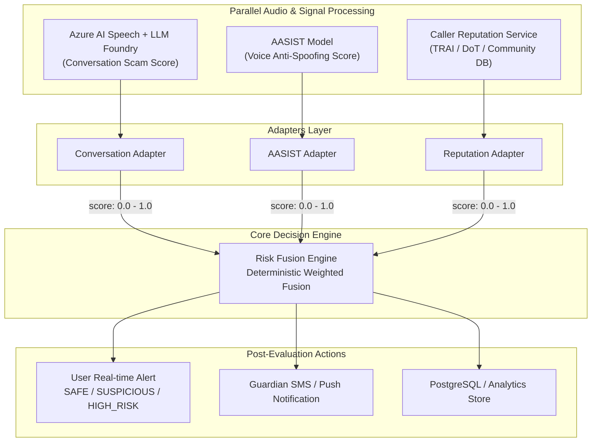

# Voice Phishing Evaluator — Risk Fusion Engine

[](https://www.python.org/)
[](https://fastapi.tiangolo.com/)
[](https://docs.pydantic.dev/)
[]()

The **Risk Fusion Engine** is the deterministic decision-making core of the **Voice Phishing Evaluator** system. It combines three independent signals into a transparent, explainable final risk score and classification (`SAFE`, `SUSPICIOUS`, or `HIGH_RISK`).

---

## 1. System Architecture & Signals



### The Three Independent Signals:
1. **Conversation Scam Score ($w_1 = 0.50$):** Semantic evaluation from Azure AI Speech transcripts analyzed by an LLM via Azure AI Foundry. Detects urgency, authority impersonation, OTP requests, and financial pressure.
2. **Voice Spoof Score ($w_2 = 0.30$):** Spectro-temporal analysis from the AASIST model estimating whether audio is bona-fide human speech or synthetic/cloned speech.
3. **Caller Reputation Score ($w_3 = 0.20$):** Phone number lookup against telecom databases (TRAI/DoT scam records, community fraud reports).

---

## 2. Mathematical Scoring & Classification

### Scoring Formula:
$$\text{final\_risk\_score} = (0.50 \times \text{conversation\_scam\_score}) + (0.30 \times \text{voice\_spoof\_score}) + (0.20 \times \text{caller\_reputation\_score})$$

- All scores are normalized to $[0.0, 1.0]$ ($0.0 = \text{lowest risk}$, $1.0 = \text{highest risk}$).
- Inverted trust scores: Providers returning trust scores are explicitly converted via $\text{risk} = 1.0 - \text{trust\_score}$.
- Weights are strictly validated: non-negative and $\sum w_i = 1.00$.

### Classification Thresholds:
| Score Range | Classification | Description |
|---|---|---|
| **$0.00 - 0.39$** | `SAFE` | Genuine human conversation from verified or normal caller. |
| **$0.40 - 0.69$** | `SUSPICIOUS` | Elevated risk; borderline indicators warranting user vigilance. |
| **$0.70 - 1.00$** | `HIGH_RISK` | High-confidence scam; triggers real-time warning & guardian alert. |

> **Threshold Integrity:** Risk scores are classified using unrounded floating precision to prevent silent boundary drift (e.g., $0.399$ is strictly `SAFE`, not rounded to $0.40$).

---

## 3. Directory Layout

```text
Vi-Shield/
├── app/
│   ├── api/
│   │   ├── __init__.py
│   │   └── routes.py              # FastAPI endpoints (/health, /config, /evaluate, etc.)
│   ├── core/
│   │   ├── __init__.py
│   │   └── config.py              # Central configuration & weight/threshold validators
│   ├── schemas/
│   │   ├── __init__.py
│   │   └── risk.py                # Pydantic input, output, evidence, and batch schemas
│   ├── services/
│   │   ├── __init__.py
│   │   ├── fusion_engine.py       # Core deterministic fusion logic (0 external ML deps)
│   │   └── explanation_service.py # Context-aware explainability generator
│   ├── adapters/
│   │   ├── __init__.py
│   │   ├── base.py                # Generic BaseSignalAdapter interface
│   │   ├── conversation_adapter.py# Normalizes Azure AI Speech + LLM Foundry outputs
│   │   ├── aasist_adapter.py      # Normalizes AASIST logits/probabilities
│   │   ├── reputation_adapter.py  # Inverts trust scores & normalizes telecom lookups
│   │   └── fusion_input_builder.py# Assembles adapter signals into evaluation requests
│   ├── mocks/
│   │   ├── __init__.py
│   │   └── scenarios.py           # Predefined deterministic mock scenarios
│   ├── __init__.py
│   └── main.py                    # Application entrypoint & OpenAPI setup
├── tests/
│   ├── __init__.py
│   ├── conftest.py                # Pytest fixtures and test clients
│   ├── test_fusion_engine.py      # Scoring calculations, boundaries, and validation tests
│   ├── test_api.py                # End-to-end HTTP endpoint and validation tests
│   ├── test_adapters.py           # Adapter normalization, trust inversion, logit tests
│   └── test_scenarios.py          # Determinism and mock scenarios tests
├── docs/
│   └── TEAM_INTEGRATION_GUIDE.md  # Comprehensive integration guide for teammates
├── .env.example                   # Environment configuration template
├── requirements.txt               # Project dependencies
├── pytest.ini                     # Pytest runner configuration
└── README.md                      # Project documentation
```

---

## 4. Setup & Installation

### Prerequisites
- Python 3.11+
- Windows PowerShell (or bash/zsh on Unix)

### 1. Clone & Enter Workspace
```powershell
cd "c:\Users\Taha Abbas\Vi-Shield"
```

### 2. Create and Activate Virtual Environment (Optional but recommended)
```powershell
python -m venv venv
.\venv\Scripts\Activate.ps1
```

### 3. Install Dependencies
```powershell
pip install -r requirements.txt
```

### 4. Configure Environment
```powershell
Copy-Item .env.example .env
```

---

## 5. Running the Application

### Start FastAPI Server
```powershell
uvicorn app.main:app --host 127.0.0.1 --port 8000 --reload
```

The service will start immediately:
- **Interactive OpenAPI Documentation (Swagger UI):** [http://127.0.0.1:8000/docs](http://127.0.0.1:8000/docs)
- **ReDoc Documentation:** [http://127.0.0.1:8000/redoc](http://127.0.0.1:8000/redoc)
- **Health Endpoint:** [http://127.0.0.1:8000/health](http://127.0.0.1:8000/health)

---

## 6. Running Tests

Run the full automated pytest suite:

```powershell
python -m pytest
```

### Test Coverage Highlights:
- **60 Automated Unit & Integration Tests (100% passing)**
- Weighted formula calculations ($0.50, 0.30, 0.20$ and custom weights)
- Exact threshold boundaries: $0.00$, $0.39$, $0.399$, $0.40$, $0.69$, $0.699$, $0.70$, $1.00$
- Boundary validations (negative values, $> 1.0$, empty IDs)
- Missing signal rejection policy (HTTP 422 on incomplete requests)
- Inversion of Caller Reputation trust scores ($1.0 - \text{trust}$)
- AASIST logit sigmoid conversion & bonafide probability inversion
- Deterministic mock scenarios and batch evaluation limits

---

## 7. API Reference & Example Commands

### 1. Health Check
```powershell
Invoke-RestMethod -Uri "http://127.0.0.1:8000/health" -Method Get
```
```bash
curl -X GET "http://127.0.0.1:8000/health"
```
**Response:**
```json
{
  "status": "healthy",
  "service": "Voice Phishing Evaluator - Risk Fusion Engine",
  "version": "1.0.0"
}
```

---

### 2. View Active Configuration & Thresholds
```powershell
Invoke-RestMethod -Uri "http://127.0.0.1:8000/config" -Method Get
```
```bash
curl -X GET "http://127.0.0.1:8000/config"
```
**Response:**
```json
{
  "app_name": "Voice Phishing Evaluator - Risk Fusion Engine",
  "app_version": "1.0.0",
  "weights": {
    "conversation": 0.50,
    "voice_authenticity": 0.30,
    "caller_reputation": 0.20
  },
  "thresholds": {
    "safe_max": 0.39,
    "suspicious_min": 0.40,
    "suspicious_max": 0.69,
    "high_risk_min": 0.70
  },
  "missing_signal_policy": "REJECT",
  "policy_description": "By default, incomplete fusion requests are strictly rejected with HTTP 422..."
}
```

---

### 3. Evaluate Single Call Risk
```powershell
$payload = @{
    call_id = "call-001"
    conversation_scam_score = 0.85
    voice_spoof_score = 0.90
    caller_reputation_score = 0.70
    source = "mock"
    metadata = @{
        language = "Hinglish"
        duration_seconds = 45
    }
} | ConvertTo-Json

Invoke-RestMethod -Uri "http://127.0.0.1:8000/api/v1/risk/evaluate" -Method Post -Body $payload -ContentType "application/json"
```
```bash
curl -X POST "http://127.0.0.1:8000/api/v1/risk/evaluate" \
  -H "Content-Type: application/json" \
  -d '{
    "call_id": "call-001",
    "conversation_scam_score": 0.85,
    "voice_spoof_score": 0.90,
    "caller_reputation_score": 0.70,
    "source": "mock",
    "metadata": {
      "language": "Hinglish",
      "duration_seconds": 45
    }
  }'
```
**Response:**
```json
{
  "call_id": "call-001",
  "final_risk_score": 0.835,
  "risk_level": "HIGH_RISK",
  "components": {
    "conversation_scam_score": 0.85,
    "voice_spoof_score": 0.90,
    "caller_reputation_score": 0.70
  },
  "weighted_contributions": {
    "conversation": 0.425,
    "voice_authenticity": 0.270,
    "caller_reputation": 0.140
  },
  "weights": {
    "conversation": 0.50,
    "voice_authenticity": 0.30,
    "caller_reputation": 0.20
  },
  "evidence": null,
  "explanation": "High conversation scam indicators, a high voice spoof score, suspicious caller reputation contributed to the high overall risk."
}
```

---

### 4. Evaluate Batch of Calls
```powershell
$batch = @{
    calls = @(
        @{ call_id = "c-1"; conversation_scam_score = 0.10; voice_spoof_score = 0.05; caller_reputation_score = 0.05 },
        @{ call_id = "c-2"; conversation_scam_score = 0.95; voice_spoof_score = 0.90; caller_reputation_score = 0.85 }
    )
} | ConvertTo-Json -Depth 3

Invoke-RestMethod -Uri "http://127.0.0.1:8000/api/v1/risk/evaluate-batch" -Method Post -Body $batch -ContentType "application/json"
```
```bash
curl -X POST "http://127.0.0.1:8000/api/v1/risk/evaluate-batch" \
  -H "Content-Type: application/json" \
  -d '{
    "calls": [
      { "call_id": "c-1", "conversation_scam_score": 0.10, "voice_spoof_score": 0.05, "caller_reputation_score": 0.05 },
      { "call_id": "c-2", "conversation_scam_score": 0.95, "voice_spoof_score": 0.90, "caller_reputation_score": 0.85 }
    ]
  }'
```

---

### 5. Evaluate Development Mock Scenario
Predefined scenarios available:
- `safe_call`
- `suspicious_call`
- `high_risk_scam`
- `synthetic_voice_scam`

```powershell
Invoke-RestMethod -Uri "http://127.0.0.1:8000/api/v1/risk/evaluate-mock" `
  -Method Post `
  -Body '{"scenario": "high_risk_scam"}' `
  -ContentType "application/json"
```
```bash
curl -X POST "http://127.0.0.1:8000/api/v1/risk/evaluate-mock" \
  -H "Content-Type: application/json" \
  -d '{"scenario": "high_risk_scam"}'
```

---

## 8. Team Integration

Refer to [TEAM_INTEGRATION_GUIDE.md](docs/TEAM_INTEGRATION_GUIDE.md) for full instructions on mapping Azure AI Speech/Foundry transcripts, AASIST audio embeddings, and telecom database lookups through the provided adapters.
