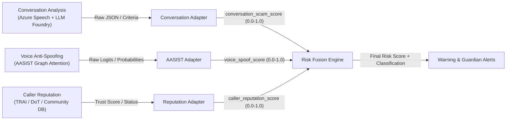

# Voice Phishing Evaluator — Teammate Integration Guide

This guide specifies the interface contracts, normalization conventions, and adapter patterns required to integrate upstream services into the **Risk Fusion Engine**.

---

## 1. System Overview & Interface Contracts

The Risk Fusion Engine acts as the central decision layer for the Voice Phishing Evaluator. It deterministically combines three independent signals into a unified risk assessment:

$$\text{Final Risk Score} = (0.50 \times \text{conversation\_scam\_score}) + (0.30 \times \text{voice\_spoof\_score}) + (0.20 \times \text{caller\_reputation\_score})$$

### Core Normalization Rule:
**Every signal delivered to the engine MUST be normalized to a floating-point score strictly within $[0.0, 1.0]$.**
- **$0.0$** = Lowest detected risk (benign, authentic, or trusted)
- **$1.0$** = Highest detected risk (phishing, deepfake spoof, or confirmed scammer)



---

## 2. Component 1: Conversation Analysis Integration

**Team Responsibilities:** Speech-to-text transcript generation (Azure AI Speech) and semantic scam analysis (LLM via Azure AI Foundry).

### Input Convention
- **Score:** `conversation_scam_score` $\in [0.0, 1.0]$
- `0.0` = Completely benign, natural personal or business conversation
- `1.0` = Definite phishing/scam attack

### Normalization Logic & Adapter Guide (`app/adapters/conversation_adapter.py`)

Depending on your LLM prompt and output format:

1. **Direct Probability Output:**
   If your Azure AI Foundry prompt outputs a calibrated `overall_scam_probability`, provide it directly:
   ```json
   { "overall_scam_probability": 0.88 }
   ```

2. **Categorical Labels:**
   If your prompt outputs classification labels:
   - `SAFE` / `BENIGN` $\rightarrow$ Map to `0.10`
   - `SUSPICIOUS` $\rightarrow$ Map to `0.50`
   - `SCAM` / `FRAUD` $\rightarrow$ Map to `0.90` (or `0.95`)

3. **Criterion-wise Evaluation (Recommended):**
   If evaluating the 6 phishing indicators from the architecture document:
   - `authority_impersonation` (weight: 0.25)
   - `credential_otp_requests` (weight: 0.25)
   - `payment_requests` (weight: 0.20)
   - `urgency_fear` (weight: 0.15)
   - `isolation_secrecy` (weight: 0.10)
   - `trust_manipulation` (weight: 0.05)

   The adapter aggregates these criteria and applies a critical indicator boost if high-severity items (e.g. OTP solicitation $\ge 0.85$) are present, preventing critical threats from being masked.

---

## 3. Component 2: Voice Anti-Spoofing (AASIST) Integration

**Team Responsibilities:** Audio feature extraction (Spectro-Temporal Graph Attention Network) on audio chunks.

### Input Convention
- **Score:** `voice_spoof_score` $\in [0.0, 1.0]$
- `0.0` = Bona-fide natural human speech
- `1.0` = Synthetic, cloned, or voice-converted speech

### Normalization Logic & Adapter Guide (`app/adapters/aasist_adapter.py`)

AASIST models typically output binary classification scores. Standard conversions:

1. **Two-Class Softmax Output:**
   - AASIST outputs `[p_bonafide, p_spoof]`.
   - Pass `p_spoof` directly as `voice_spoof_score`.

2. **Single Bonafide Probability:**
   - If your checkpoint only outputs `p_bonafide`:
     $$\text{voice\_spoof\_score} = 1.0 - p_{\text{bonafide}}$$

3. **Raw Logit ($z$):**
   - If your pipeline extracts raw logits before softmax:
     $$\text{voice\_spoof\_score} = \sigma(z) = \frac{1}{1 + e^{-z}}$$

4. **Binary Labels:**
   - `BONAFIDE` $\rightarrow$ `0.05`
   - `SPOOF` $\rightarrow$ `0.95`

---

## 4. Component 3: Caller Reputation Service Integration

**Team Responsibilities:** Caller phone number lookup against telecom databases (TRAI/DoT scam database, community reports).

### Input Convention
- **Score:** `caller_reputation_score` $\in [0.0, 1.0]$
- `0.0` = Low risk (whitelisted, personal contact, verified company)
- `1.0` = High risk (blacklisted, high complaint volume, confirmed scam number)

### ⚠️ CRITICAL: Inverting Trust Scores (`app/adapters/reputation_adapter.py`)
Many external reputation providers (Truecaller, telecom registries) return a **Trust Score** where $1.0 = \text{trusted}$ and $0.0 = \text{untrusted}$.

**You MUST invert trust scores before fusion:**
$$\text{caller\_reputation\_score} = 1.0 - \text{trust\_score}$$

- Trust Score $0.95 \implies$ Risk Score $0.05$ (SAFE)
- Trust Score $0.10 \implies$ Risk Score $0.90$ (HIGH RISK)

### Categorical Registry Status:
- `VERIFIED_SAFE` / `TRUSTED` $\rightarrow$ `0.05` / `0.10`
- `UNKNOWN` / `NEUTRAL` $\rightarrow$ `0.30`
- `SUSPICIOUS` / `SPAM` $\rightarrow$ `0.65` / `0.70`
- `BLACKLISTED` / `CONFIRMED_SCAM` $\rightarrow$ `0.95` / `0.98`

If a number is listed in the official TRAI/DoT scam database, the adapter automatically sets minimum risk to $\ge 0.85$.

---

## 5. End-to-End Orchestration Example

To combine all three signals in Python without manual JSON formatting:

```python
from app.adapters.conversation_adapter import ConversationAdapter, RawConversationLLMOutput, PhishingCriterionScores
from app.adapters.aasist_adapter import AASISTAdapter, RawAASISTOutput
from app.adapters.reputation_adapter import ReputationAdapter, RawReputationLookup, ReputationScoreType
from app.adapters.fusion_input_builder import build_evaluation_request
from app.services.fusion_engine import RiskFusionEngine

# 1. Initialize adapters
conv_adapter = ConversationAdapter()
aasist_adapter = AASISTAdapter()
rep_adapter = ReputationAdapter()
engine = RiskFusionEngine()

# 2. Normalize outputs from each component
conv_sig = conv_adapter.normalize(RawConversationLLMOutput(
    call_id="call-100",
    overall_scam_probability=0.88,
    criteria=PhishingCriterionScores(authority_impersonation=0.90, credential_otp_requests=0.95)
))

voice_sig = aasist_adapter.normalize(RawAASISTOutput(
    call_id="call-100",
    spoof_probability=0.92
))

rep_sig = rep_adapter.normalize(RawReputationLookup(
    phone_number="+91-9876543210",
    score_type=ReputationScoreType.TRUST,
    raw_score=0.15 # Inverts to 0.85 risk
))

# 3. Assemble and evaluate
request_payload = build_evaluation_request("call-100", conv_sig, voice_sig, rep_sig)
result = engine.evaluate(request_payload)

print(f"Risk Level: {result.risk_level} (Score: {result.final_risk_score})")
print(f"Explanation: {result.explanation}")
```

---

## 6. Sample Request & Response Payloads

### POST `/api/v1/risk/evaluate`

#### Request Payload:
```json
{
  "call_id": "call-001",
  "conversation_scam_score": 0.85,
  "voice_spoof_score": 0.90,
  "caller_reputation_score": 0.70,
  "source": "live_pipeline",
  "metadata": {
    "language": "Hinglish",
    "duration_seconds": 45,
    "caller_number": "+91-9876543210"
  },
  "evidence": {
    "bank_impersonation": true,
    "urgency_or_fear": true,
    "otp_or_credential_request": true,
    "synthetic_voice_detected": true,
    "reported_scam_category": "TRAI/DoT Flagged Financial Scam",
    "complaints_count": 14,
    "indicators": [
      "Authority/Bank impersonation",
      "Threat of account suspension",
      "OTP credential solicitation"
    ]
  }
}
```

#### Response Payload:
```json
{
  "call_id": "call-001",
  "final_risk_score": 0.835,
  "risk_level": "HIGH_RISK",
  "components": {
    "conversation_scam_score": 0.85,
    "voice_spoof_score": 0.90,
    "caller_reputation_score": 0.70
  },
  "weighted_contributions": {
    "conversation": 0.425,
    "voice_authenticity": 0.27,
    "caller_reputation": 0.14
  },
  "weights": {
    "conversation": 0.50,
    "voice_authenticity": 0.30,
    "caller_reputation": 0.20
  },
  "evidence": {
    "bank_impersonation": true,
    "urgency_or_fear": true,
    "otp_or_credential_request": true,
    "payment_request": null,
    "isolation_tactics": null,
    "synthetic_voice_detected": true,
    "spoof_confidence": null,
    "reported_scam_category": "TRAI/DoT Flagged Financial Scam",
    "complaints_count": 14,
    "indicators": [
      "Authority/Bank impersonation",
      "Threat of account suspension",
      "OTP credential solicitation"
    ]
  },
  "explanation": "High conversation scam indicators, a high voice spoof score, suspicious caller reputation contributed to the high overall risk. Upstream evidence noted: authority/bank impersonation, credential/OTP request, urgency tactics, synthetic voice artifacts, reputation flag: TRAI/DoT Flagged Financial Scam, Threat of account suspension."
}
```

---

## 7. Operational Policies & Missing Signals

- **Policy for Missing Signals:** By default, incomplete fusion requests are **strictly rejected with HTTP 422**. The engine will never invent default scores or silently coerce missing values to zero.
- **Batch Evaluation:** Batch calls can be submitted via `POST /api/v1/risk/evaluate-batch` (maximum 100 calls per batch).
- **Thresholds Reference:**
  - `0.00 – 0.39`: `SAFE`
  - `0.40 – 0.69`: `SUSPICIOUS`
  - `0.70 – 1.00`: `HIGH_RISK`
