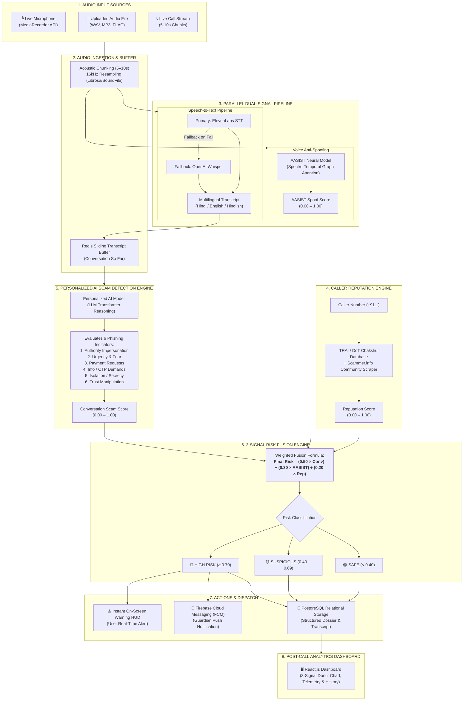

# ViShield (Voice Phishing Evaluator) — PPT Slide Updates

This document contains the exact updated text and design instructions for the **3 presentation slides**:
1. **Slide 1: Tech Stack**
2. **Slide 2: Proposed Solution**
3. **Slide 3: Architecture Diagram (with AI Generation Prompts & Mermaid Code)**

---

## 📽️ SLIDE 1: TECH STACK

### Slide Title: **TECH STACK**

#### Bullet Points for Slide:
* **Frontend / Dashboard:** React.js (Vite, Tailwind CSS, Google Material Symbols, Lucide Icons)
* **Backend Framework:** FastAPI (Python 3.10+), Uvicorn ASGI Server
* **Speech-to-Text (STT):** ElevenLabs Scribe API *(Primary)* with automatic fallback to OpenAI Whisper
* **Scam Detection Engine:** Personalized AI Model for Scam Detection (Transformer LLM Context Reasoning across 6 Phishing Criteria)
* **Voice Anti-Spoofing:** AASIST (Spectro-Temporal Graph Attention Network in PyTorch & TorchAudio)
* **Caller Reputation Engine:** TRAI / DoT Heuristics (140/160 series, VoIP detection) + Scammer.info Discourse Community Scraper
* **Database & Persistence:** PostgreSQL (Relational Post-Call Storage & Telemetry) + SQLAlchemy ORM
* **In-Memory Buffer / Caching:** Redis (5–10s Acoustic Chunking & Sliding Window Transcript Buffer)
* **Real-Time Notifications:** Firebase Cloud Messaging (FCM Push Alerts to Pre-Registered Guardians)
* **Audio Capture & Analysis:** Web MediaRecorder API (Live Mic with Rehear & Waveform) + Librosa / SoundFile (16kHz Resampling)
* **Deployment & Orchestration:** Docker, Azure Kubernetes Service (AKS)
* **Observability & Version Control:** OpenTelemetry + Grafana, Git & GitHub

> **Speaker Note / Key Highlight:**
> *"Our tech stack is designed for low-latency multimodal verification. We decouple acoustic voice clone detection (AASIST) from contextual linguistic reasoning (Personalized AI Model) and external telecom reputation, creating a fault-tolerant pipeline with ElevenLabs and Whisper STT fallback."*

---

## 💡 SLIDE 2: PROPOSED SOLUTION

### Slide Title: **PROPOSED SOLUTION**

#### Subtitle / Lead Paragraph:
**ViShield (Voice Phishing Evaluator)** is an AI-powered defense system that detects voice phishing (vishing) and deepfake audio calls across **Hindi, English, and Hinglish** by analyzing acoustic chunks and conversation semantics in real time.

#### Working Process (Clean Bullet Points for Slide):
* **Dual Audio Ingestion:** Ingests audio from live calls, microphone input (with instant rehear), or recorded audio files (WAV, MP3, FLAC).
* **Multilingual Speech-to-Text:** Transcribes spoken audio using **ElevenLabs STT API**, with automatic fallback to **Whisper STT** for zero downtime.
* **Contextual Scam Analysis:** Analyzes conversation transcripts using a **Personalized AI Model for Scam Detection** against the **Six Phishing Indicators** (Authority Impersonation, Urgency/Fear Tactics, Payment Requests, Credential/OTP Requests, Isolation/Secrecy, and Trust Manipulation).
* **Deepfake & Clone Detection:** Processes acoustic features through the **AASIST Graph Attention Model** to identify synthetic voices, AI clones, and replay attacks.
* **Telecom Reputation Verification:** Validates caller phone numbers against TRAI/DoT registries, national blacklists, and crowdsourced scam databases.
* **3-Signal Risk Fusion:** Combines scores via weighted formula:
  $$\text{Final Risk} = (0.50 \times \text{Conversation}) + (0.30 \times \text{AASIST Spoof}) + (0.20 \times \text{Reputation})$$
  and classifies into **Safe (<40%)**, **Suspicious (40–69%)**, or **High Risk (≥70%)**.
* **Automated Dual Defense Action:** Immediately renders an on-screen **Warning HUD** to the user and dispatches a **Firebase FCM push alert** with call telemetry to a pre-registered family guardian for high-risk calls.
* **Post-Call Relational Dossier:** Commits complete transcripts, acoustic metrics, and indicator scores into PostgreSQL for audit and forensic review.

---

## 🏛️ SLIDE 3: ARCHITECTURE DIAGRAM & PROMPTS

### Option A: Ready-to-Use Mermaid.js Code
*(Copy and paste directly into [Mermaid Live Editor](https://mermaid.live), Draw.io via Insert → Advanced → Mermaid, or Notion/GitHub markdown)*



---

### Option B: AI Image Generation Prompt
*(Use this prompt in **ChatGPT (GPT-4o / DALL-E 3)**, **Midjourney v6**, or **Ideogram** to generate a clean, modern architecture diagram visual)*

```text
A professional, modern system architecture diagram for an AI cybersecurity software called "ViShield - Voice Phishing Evaluator". Clean minimalist white background with high contrast, sharp geometric card boxes, sleek rounded rectangles, modern tech typography, and organized flow arrows.

The diagram is organized into clean visual stages from left to right:
1. INPUT SOURCES: Phone icon with "Live Call Stream (5-10s Chunks)", Mic icon with "Live Microphone Input", and Folder icon with "Uploaded Audio (WAV/MP3/FLAC)".
2. AUDIO INGESTION: Soundwave graphic labeled "Acoustic Chunking & 16kHz Resampling", connected to a cache box labeled "Redis Sliding Transcript Buffer".
3. DUAL PARALLEL PROCESSING:
   - Branch A (Speech Recognition): "ElevenLabs STT (Primary)" with fallback dotted arrow to "Whisper STT (Fallback)" outputting "Multilingual Text (Hindi/English/Hinglish)".
   - Branch B (Voice Anti-Spoofing): Purple neural network icon with "AASIST Model (Spectro-Temporal Graph Attention)" outputting "Voice Spoof Score (w2=30%)".
4. CALLER REPUTATION SERVICE: Red shield icon labeled "TRAI / DoT Blacklist & Scammer.info Community Scraper" outputting "Caller Reputation Score (w3=20%)".
5. SCAM DETECTION ENGINE: Brain AI icon labeled "Personalized AI Model for Scam Detection" analyzing "Six Phishing Indicators (Authority, Urgency, Payment, OTP, Isolation, Trust)" outputting "Conversation Scam Score (w1=50%)".
6. RISK FUSION ENGINE: Central green gear node labeled "Tri-Signal Weighted Fusion: (0.50×Conv) + (0.30×Spoof) + (0.20×Rep)" branching into three status pills: Green "SAFE (<40%)", Yellow "SUSPICIOUS (40-69%)", and Red "HIGH RISK (≥70%)".
7. OUTPUT & DISPATCH:
   - Red phone banner: "Instant Warning HUD (User Alert)"
   - Orange bell icon: "Firebase FCM Guardian Push Notification"
   - Blue database icon: "PostgreSQL Relational Storage (Dossiers & Transcripts)"
   - Cyan monitor icon: "React.js Post-Call Analytics Dashboard with 3-Signal Donut Chart"

Color palette: Deep navy blue, clean slate gray borders, emerald green, amber yellow, alert crimson red, and cyber cyan accents. Ultra crisp lines, 4k vector presentation slide graphic style, infographic clarity, no messy text artifacts.
```

---

### Option C: Text-to-Diagram Prompt (For Draw.io / Eraser.io / Napkin.ai / Whimsical)

```text
Create a clean system architecture diagram for "ViShield: Voice Phishing Evaluator & Defense Matrix".

Layout & Modules:
- Container 1 (Left - Ingestion):
  - Box 1A: Audio Input (Live Mic with Rehear, Uploaded Audio WAV/MP3, Phone Stream)
  - Box 1B: Audio Chunking (5-10s chunks, 16kHz resample via Librosa)
  - Box 1C: Redis Cache (Sliding transcript window buffer)

- Container 2 (Top Middle - Acoustic Analysis):
  - Box 2A: AASIST Model (PyTorch Spectro-Temporal Graph Attention Network) -> Outputs "Voice Authenticity / Deepfake Spoof Score (0.00-1.00)"

- Container 3 (Middle - Linguistic & Semantic Analysis):
  - Box 3A: Speech-to-Text: ElevenLabs API (Primary) with fallback arrow to OpenAI Whisper STT (Fallback)
  - Box 3B: Personalized AI Model for Scam Detection (Transformer LLM) evaluating Six Phishing Indicators: Authority Impersonation, Urgency & Fear, Payment Demands, OTP Requests, Isolation & Secrecy, Trust Manipulation -> Outputs "Conversation Scam Score (0.00-1.00)"

- Container 4 (Bottom Middle - Caller Reputation):
  - Box 4A: Caller Reputation Engine: TRAI/DoT 140/160 series verification + Scammer.info Discourse Scraper -> Outputs "Caller Reputation Score (0.00-1.00)"

- Container 5 (Right Middle - Risk Fusion):
  - Box 5A: Risk Fusion Engine: Final Risk = (0.50 * Conversation) + (0.30 * AASIST) + (0.20 * Reputation)
  - Box 5B: Multi-threshold Classifier: Safe (<0.40), Suspicious (0.40-0.69), High Risk (>=0.70)

- Container 6 (Far Right - Response & Storage):
  - Box 6A: User Warning HUD (Real-time in-call alert)
  - Box 6B: Guardian FCM Push (Firebase Cloud Messaging alert sent to family/guardian)
  - Box 6C: PostgreSQL Database (Stores full transcripts, 3-signal scores, and forensic metadata)
  - Box 6D: React.js Post-Call Dashboard (Visualizes 3-signal donut chart, incident history, and call analysis report)

Connections:
- Audio Ingestion feeds simultaneously into AASIST Model and Speech-to-Text.
- Speech-to-Text pushes text into Redis buffer, which feeds into the Personalized AI Scam Detection Engine.
- Caller number feeds into Caller Reputation Engine.
- Outputs from Scam Engine (50%), AASIST (30%), and Reputation (20%) all converge into Risk Fusion Engine.
- Risk Fusion triggers User Warning and Guardian FCM Notification for High-Risk calls, and commits record to PostgreSQL Database.
- PostgreSQL Database populates the React.js Post-Call Dashboard.
```
